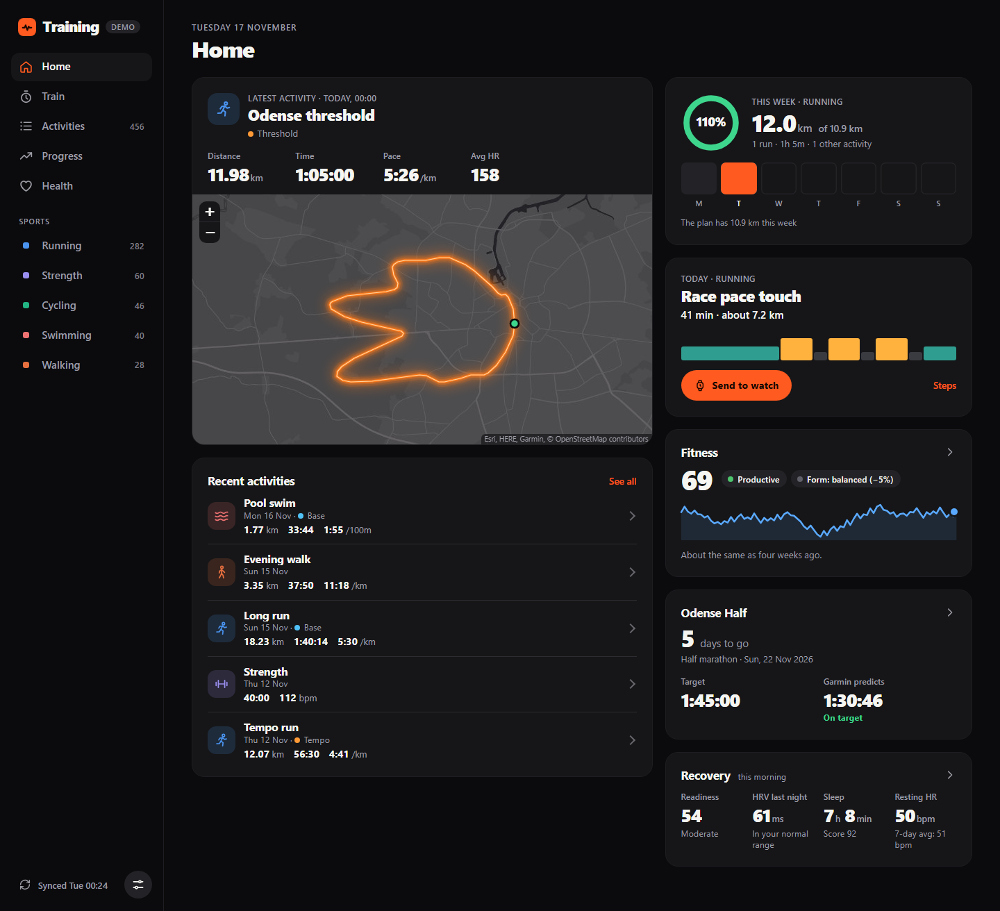
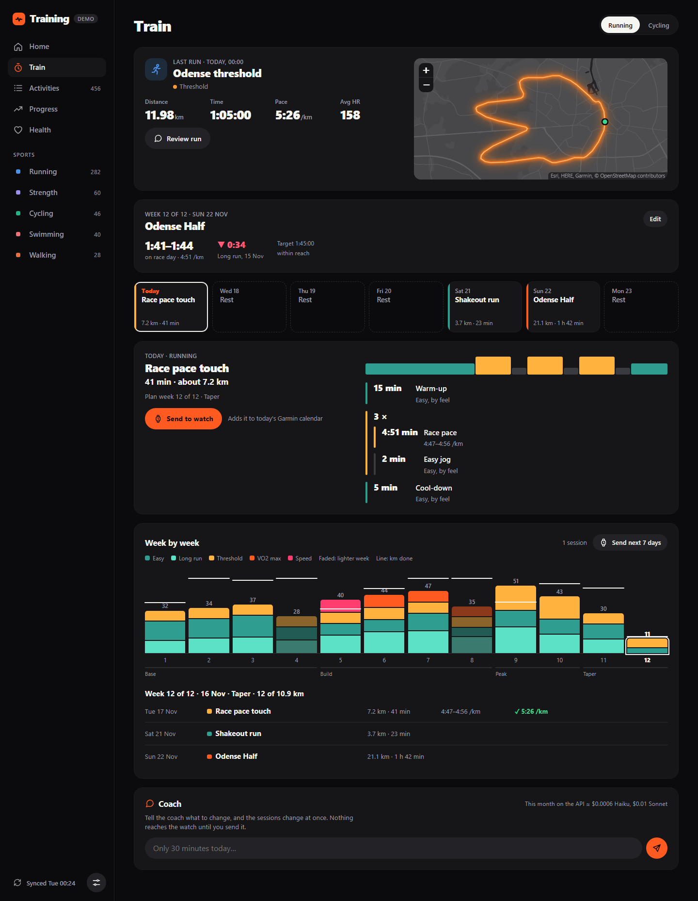
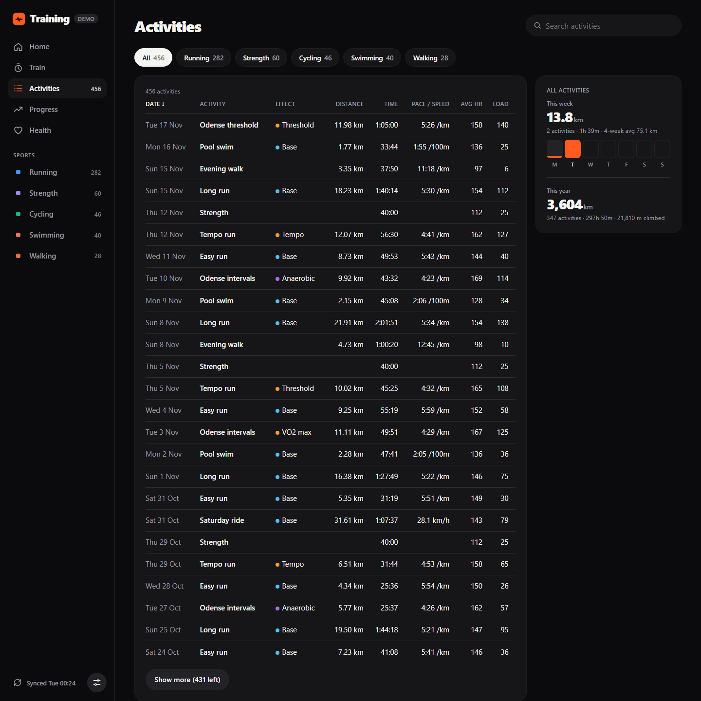
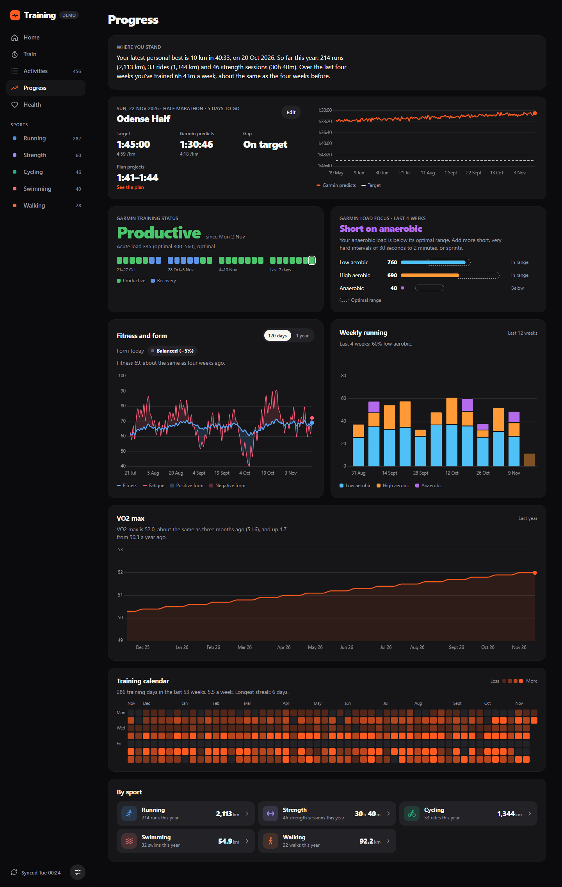
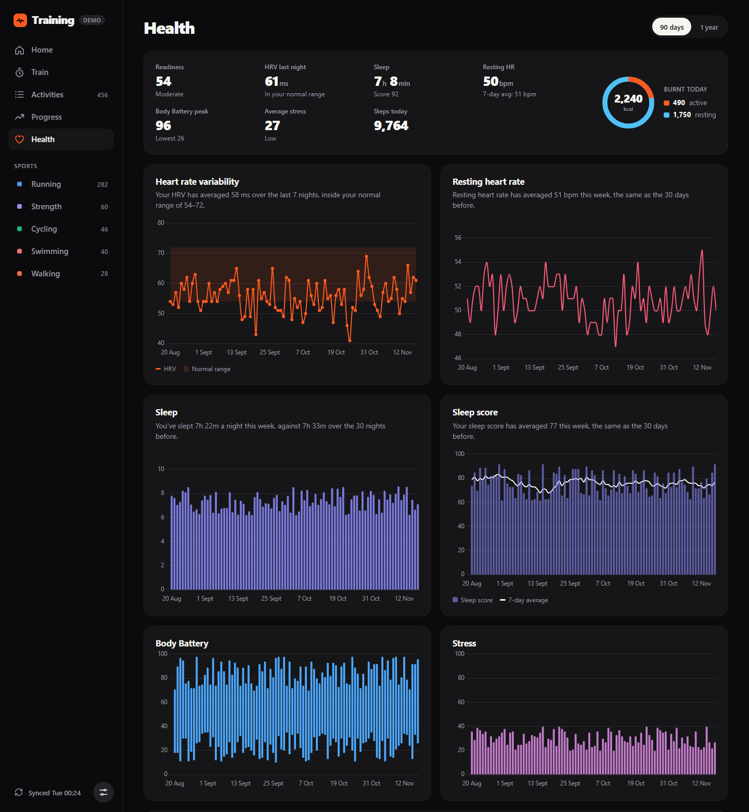
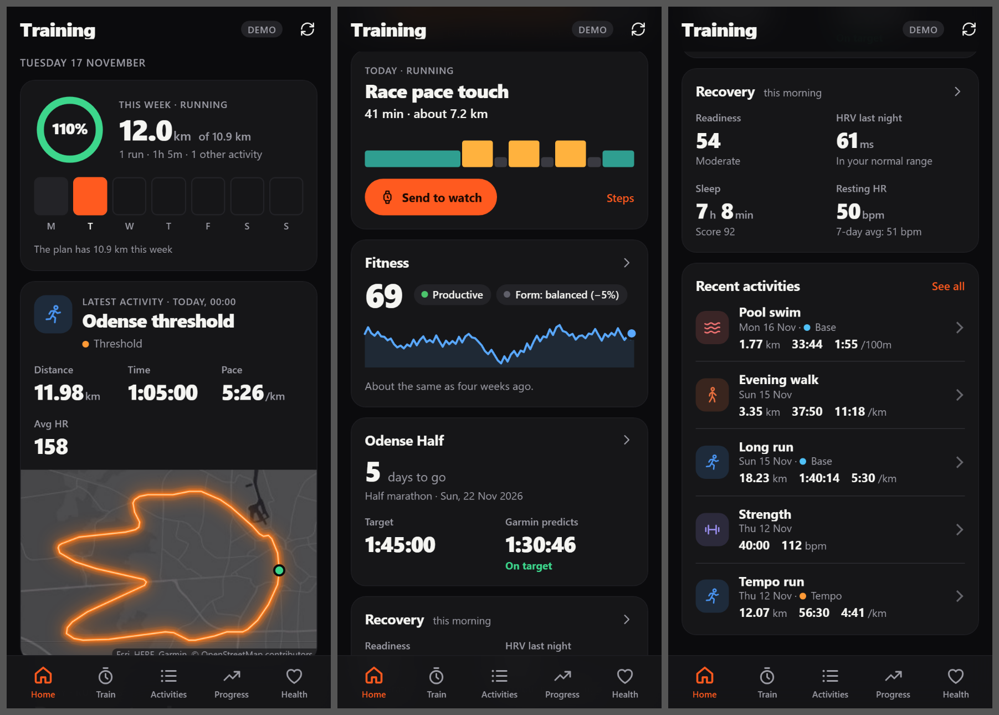

# Training

A personal training dashboard. It syncs your Garmin Connect data to a local SQLite database and shows it in the browser, on this PC or any device on your wifi. Built with FastAPI and Chart.js, with no build step. Everything is bundled, so it works offline apart from the map tiles.

## Setup

Needs Python 3.10+. The commands are for Windows; run them in the project folder.

```bash
python -m venv .venv
.venv\Scripts\pip install -r requirements.txt
copy .env.example .env
.venv\Scripts\python backend/login.py
```

`login.py` asks for your Garmin login once and keeps a token in `TOKEN_DIR`. Your password is never stored.

## Starting it

- **`Dashboard app.bat`** opens the dashboard in its own window. It connects to `DASHBOARD_URL`, or this PC; if no server is running, it starts one until the window closes. If the window is already open, it brings that one to the front. Add `--demo` for made-up data. Its log is `data/desktop.log`.
- **`.venv\Scripts\python backend/app.py`** runs only the server (`--demo` works here too). Open `http://localhost:8000`, or the wifi address it prints. Windows may ask to let Python through the firewall the first time.

For a desktop shortcut, right-click the `.bat` → **Send to** → **Desktop (create shortcut)**, and pick an icon from `assets/` under **Properties** → **Change Icon…**.

## Pages

Phones show the pages as tabs along the bottom, wide screens as a menu on the left with a page per sport under it. **Sync now** and **Log out** are in the settings: the button top right on phones, the one at the bottom of the menu on wide screens (where the line beside it syncs at once too).

On a phone, swipe sideways to move between the tabs; swipe right on a sport's page to go back. In an activity, swipe to the next or previous one in the list you opened it from (a week, the Activities page with its filter and sort, a sport's list, a personal best's top 5; otherwise all activities, newest first); the arrow keys do the same on a wide screen. Pull down at the top of a page to sync with Garmin. Drag a sheet or an activity down to close it (a form only by its top edge, so a stray drag can't throw away what you typed). The phone's back button works like it does in an app: it closes an open sheet or activity (or goes from an activity back to the week it was opened from), takes a sport's page back to where you opened it, takes any other tab back to Home, and leaves the app from Home. Going back also returns a page to where you'd scrolled it.

### Home



- **This week**: your main sport as a ring against the plan's week, or without a plan against the average of your last four weeks, with the week day by day.
- **Latest activity**, with its route. Tap it for the details.
- **Today's session**, with **Send to watch**.
- **Fitness**: the number and its last 12 weeks, with Garmin's training status and today's form.
- **Race goal**: days to go, the target and Garmin's prediction.
- **Recovery**: readiness, HRV, sleep and resting heart rate.
- **Recent activities**.

### Train



- **Today's activity** at the top, if it's from today or the last 12 hours. A run or ride has **Review run**, with a few lines from the coach (Claude is asked only when you press it). Done from a session sent with **Send to watch**, it's each step against its lap, how many hit their target, and the plan's verdict and what it moved; done on its own, it's the coach's written feedback: how it went, what could be better and how it fits the last 7 days.
- **Today's session** for running and cycling (and swimming with a plan that has swims), in steps like a Garmin workout. Warm-ups and cool-downs go by feel, without a target. Without a plan it's picked from readiness, recovery time, sleep, HRV and Garmin's load focus, and can be a short easy session, a recovery session or a rest day; with one, it's the plan's session, with a note to take it easy on a poor day.
- **The plan**: the next 7 days (tap a day to see it; a row to swipe on phones), and the plan week by week (tap a week for its sessions).
- **Send to watch** puts a session in the Garmin calendar, and **Send next 7 days** the plan's coming week. The watch gets them at its next sync with the Garmin Connect app. Once sent, the button reads **On the watch ✓**; press it to remove the session from the watch again (it asks first). A session on the watch stays today's session, and reads **Done ✓** once you've run it.
- **The coach**: tell it what to change ("only 40 minutes today", "move Thursday to Friday"), and the sessions change at once. Nothing reaches the watch until you send it. One chat a day; **Undo all changes** takes them back.

### Activities



- **Every activity**, searchable and filtered by sport, with this week and this year for the chosen sport. Wide screens show a table sorted by its headers; phones show rows, with a **Sort by** picker.
- **Tap an activity** for every stat Garmin has, with the route and laps. A run or ride has **Review run** there too.

### Progress



- **Race goal**: target time, Garmin's prediction and the gap, with a 6-month chart. Set with **Add a race goal**, or by a race plan.
- **Garmin's training status and load focus**, with what to train next.
- **Fitness and form**: fitness (42-day load) against fatigue (7-day), over 120 days or a year.
- **Weekly running** over 12 weeks, split by training effect (tap a week for its activities), and **VO2 max** and a **training calendar** over the last year.
- **A page per sport** done at least 3 times: totals, weeks, months, this year against last, and personal bests (tap one for its top 5).

### Health



Last night and today, then HRV against your normal range, resting heart rate, sleep and sleep score, Body Battery, stress, steps and calories, for 90 days or a year. Most have a line on this week against the 30 days before.

The screenshots use demo data.

## Training plan

Set one up with **Create a plan** on the Train page (**Edit** on the plan changes it): the plan type, the date, your run days (tick **Rides and swims too** for a multi-sport plan), the long run day and how much you run now (plus the distance and target time where the type asks). A race plan also sets the race goal.

| Plan type | What it does |
|---|---|
| Race | Builds toward a 5 km, 10 km, half or marathon, with a taper |
| Triathlon | Sprint, olympic, 70.3 or Ironman: swims, rides and runs, with bricks and a taper |
| General fitness | Builds steadily, projecting a time for a distance you pick |
| Base builder | More weekly km and a longer long run (up to 18 km), one hard session a week |
| Speed block | 6–12 weeks to get faster over 5 or 10 km: volume held, two hard sessions a week |
| Return to running | Run/walk sessions that build to continuous running, nothing hard |
| Maintenance | Holds your weekly km, one hard session a week |

| | 5 km | 10 km | Half | Marathon | Fitness |
|---|---|---|---|---|---|
| Most km a week | 35 | 45 | 50 | 70 | 45 |
| Longest run | 12 km | 16 km | 19 km | 32 km | 16 km |
| Longest run, weeks before race week | 2 | 2 | 3 | 3 | — |
| Taper | 1 week | 1 week | 2 weeks | 3 weeks | — |

- **Weekly km** grow at most 8% a week, to at most 2.5 times where you started. Every 4th week is lighter.
- **The long run** climbs on its own, up to half the week, and steps down after its peak. It's plain in the base phase and lighter weeks, then takes turns as a progressive, fast-finish or surges long run, and in the peak weeks has a race pace finish (half) or marathon pace blocks.
- **Hard sessions**: one or two a week, kept away from the long run, and named as runners know them: tempo runs, threshold progressions, cruise intervals, over/unders, 1 km and 800 m repeats, pyramids, race pace. The second is dropped when the week has no room for it.
- **Speed sessions**: 400 m repeats, 600 m repeats and 400 m sets. Mostly in 5 and 10 km plans and the speed block, now and then in the build of the others; never in the base phase, the taper or a lighter week.
- **Race week**: a short race pace session, a shakeout and the race; one short opener ride and swim.
- **Other sports**: rides ramp in hours with a long ride and one hard ride (watts from Garmin's FTP, heart rate without), swims go by distance (technique, threshold, speed, race pace). With more than runs, the chart shows hours by sport.
- **Paces adapt**: faster runs than planned make the next paces faster, slower ones slower. Intervals are judged on their laps, easy runs on pace at their heart rate.
- **Projected time**: shown as a range that narrows toward race day, for the plan types that have a distance. The header shows the last run that moved it.
- **Missed sessions**: a missed hard or long run moves to the next easy day that week.

## The coach

The coach's chat and reviews use Claude Code on this PC, covered by your Claude subscription: install it and log in once by running `claude`. With `ANTHROPIC_API_KEY` in `.env` it uses the Anthropic API instead, which is faster but billed per message: about $0.001 on Haiku (the default) or $0.02–0.03 on Sonnet (`CHAT_MODEL=sonnet`). Each reply shows its tokens and price, the chat shows this month's total, and every message (and run review) is logged in `data/chat_usage.csv`. On Claude Code it shows what the same chats would cost on the API with Haiku and with Sonnet, to compare before switching.

## Syncing

The server syncs every `SYNC_INTERVAL_MINUTES`; **Sync now** in the settings syncs at once. `backend/sync.py` syncs without the server.

- **First sync**: takes a few minutes. The rest of your history follows over the next syncs.
- **Later syncs**: the last few days, and once a day the last 30 days of activities, so edits and deletions on Garmin carry over.
- **Rate limits**: if Garmin says too many requests, the next sync carries on where it stopped.

## On your phone

Install [Tailscale](https://tailscale.com) on the PC and the phone, with the same account, and run this once on the PC:

```
tailscale serve --bg 8000
```

Open the `https://….ts.net` address it gives in Chrome on the phone, and choose **Install app**. It then opens like an app, with its own icon.



## Settings (`.env`)

| Setting | Default | What it does |
|---|---|---|
| `DASHBOARD_PASSWORD` | empty | Asks for a password. Set it if others share your wifi |
| `DASHBOARD_USERNAME` | empty | Asks for a username too |
| `DASHBOARD_URL` | empty | Where the app window connects, if the server runs on another PC |
| `HOST` / `PORT` | 0.0.0.0 / 8000 | `127.0.0.1` keeps it to this PC |
| `SYNC_INTERVAL_MINUTES` | 60 | How often it syncs |
| `ANTHROPIC_API_KEY` | empty | The coach uses the API instead of Claude Code |
| `CHAT_MODEL` | haiku | The coach's model on the API: `haiku` or `sonnet` |
| `AEROBIC_THRESHOLD` | 158 | Heart rate between easy and hard, for runs Garmin hasn't labelled |
| `MAX_HR` | 195 | For training load when Garmin has none |
| `ACTIVITY_BACKFILL_DAYS`, `DAILY_BACKFILL_DAYS`, `HEALTH_HISTORY_DAYS`, `VO2MAX_BACKFILL_DAYS` | 180, 60, 365, 1095 | How far back the first sync and the backfills go |
| `TOKEN_DIR` | ~/.garminconnect | Where the Garmin token is kept |
| `DB_PATH` | data/athlete.db | The database |

## Project layout

```
Dashboard app.bat   the app window
backend/
  app.py            server, background sync, login
  sync.py           Garmin Connect → SQLite
  metrics.py        the dashboard's numbers
  workouts.py       today's session, and Garmin's workout format
  plans.py          the training plan, and multisport.py for its rides and swims
  coach.py          the chat, and changes.py for the sessions it changes
  review.py         a run against the workout it was run from
  db.py, config.py, login.py, demo.py
frontend/           the page: index.html, styles.css, js/ (a module per page), icons/
desktop/main.py     the app window
tests/
assets/             the window's icon, and more to pick from for desktop shortcuts
docs/screenshots/   the screenshots above
data/               database and app data, not in git
```

## Tests

```bash
.venv\Scripts\python -m unittest discover tests
```

They cover the numbers, the suggested workouts, the training plan, chat changes, run reviews and the sync (against a stand-in for Garmin).

## Troubleshooting

- **Not logged in to Garmin**: run `backend/login.py` again. The token expires now and then.
- **Sync fails after a Garmin change**: run `.venv\Scripts\pip install -U garminconnect`.
- **Can't open it from the phone**: check that `HOST=0.0.0.0` and that Windows' firewall allows Python.
- **The app window says it can't reach the dashboard**: the server at `DASHBOARD_URL` isn't running, or the address is wrong. See `data/desktop.log`.
- **Tailscale says "State store failed to initialize … TPM"**: in an administrator PowerShell run `Stop-Service Tailscale; Rename-Item C:\ProgramData\Tailscale\server-state.conf server-state.conf.bak; Start-Service Tailscale; tailscale up`, then log in again.
- **Logged out on every device**: the password or username in `.env` changed.
- **Start over**: delete `data/athlete.db`. The next sync fetches everything again.
