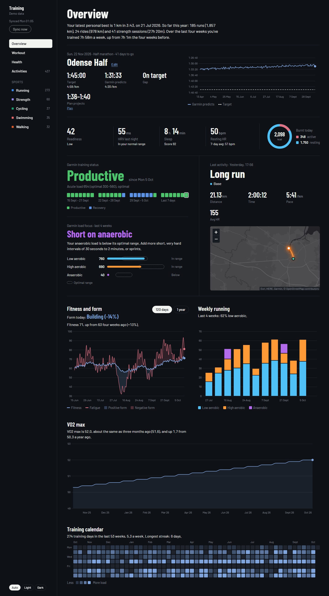
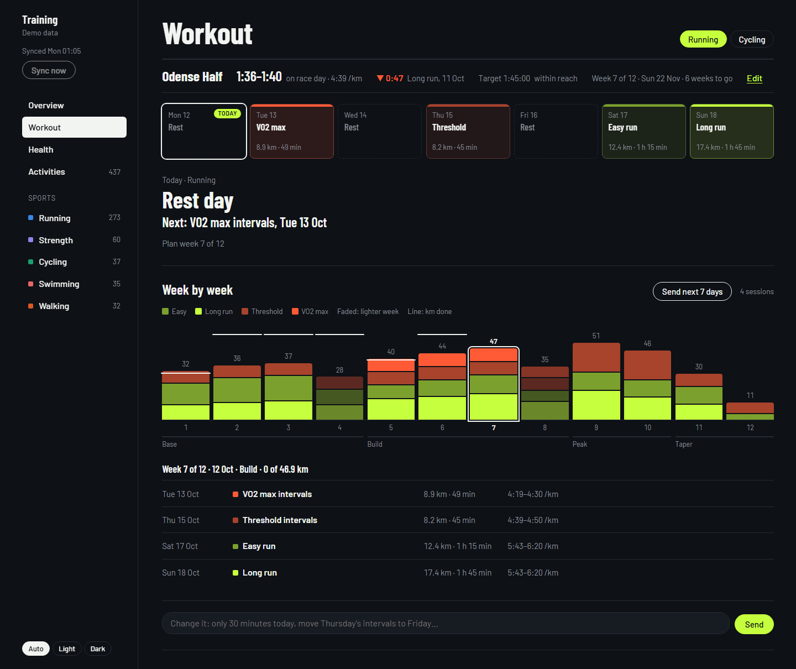
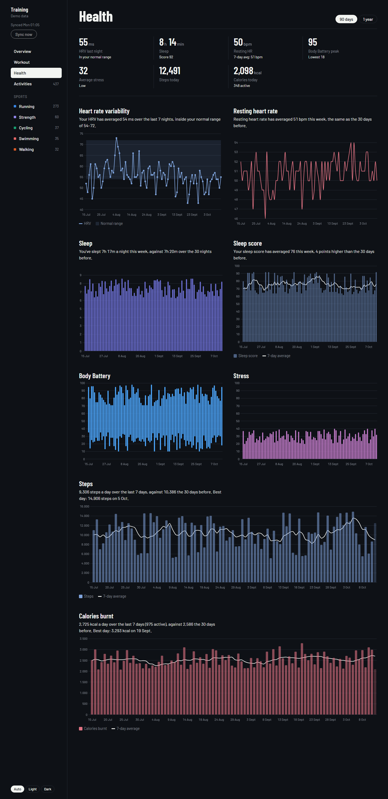
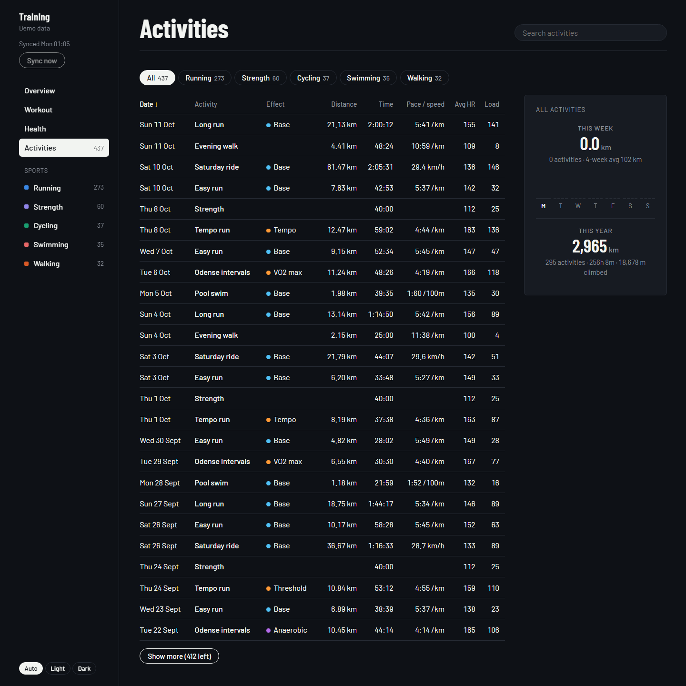

# Training

A personal training dashboard. It syncs your Garmin Connect data to a local database and shows it in the browser, on this PC or any device on your wifi.

## Setup

Needs Python 3.10+. The commands are for Windows; run them in the project folder.

```bash
python -m venv .venv
.venv\Scripts\pip install -r requirements.txt
copy .env.example .env
.venv\Scripts\python backend/login.py
```

`login.py` asks for your Garmin login once and keeps a token. Your password is never stored.

## Starting it

- **`Dashboard app.bat`** opens the dashboard in its own window. If no server is running, it starts one until the window closes. Add `--demo` for made-up data.
- **`.venv\Scripts\python backend/app.py`** runs only the server. Open `http://localhost:8000`, or the wifi address it prints.

The server syncs with Garmin every hour; **Sync now** in the menu syncs at once.

## Pages

**Overview**: race goal, today's recovery, Garmin's training status and load focus, last activity, fitness and form, weekly running, VO2 max and a training calendar.



**Workout**: today's session, a chat to change it, and the training plan. **Send to watch** puts a session in the Garmin calendar; hover **On the watch ✓** to remove it again.



**Health**: HRV, resting heart rate, sleep, Body Battery, stress, steps and calories.



**Activities**: every activity, with a page per sport and a popup with all the details.



The screenshots use demo data.

## Training plan

Set one up with **+ Training plan** on the Workout page: race or general fitness, the date, your run days and your current km a week. Paces adapt to how your runs go, and the projected race time follows.

| | 5 km | 10 km | Half | Marathon | Fitness |
|---|---|---|---|---|---|
| Most km a week | 35 | 45 | 50 | 70 | 45 |
| Longest run | 12 km | 16 km | 19 km | 32 km | 16 km |
| Longest run, weeks before race week | 2 | 2 | 3 | 3 | — |
| Taper | 1 week | 1 week | 2 weeks | 3 weeks | — |

- Weekly km grow at most 8% a week, and at most to 2.5 times where you started. Every 4th week is lighter.
- One or two hard sessions a week, kept away from the long run.
- Race week is a short race pace session, a shakeout and the race.

## The chat

The chat on the Workout page uses Claude Code on this PC. Install it and log in once by running `claude`. With `ANTHROPIC_API_KEY` in `.env`, it uses the API instead.

## On your phone

Install [Tailscale](https://tailscale.com) on the PC and the phone, and run this once on the PC:

```
tailscale serve --bg 8000
```

Open the `https://….ts.net` address it gives in Chrome on the phone, and choose **Install app**.

## Settings (`.env`)

| Setting | Default | What it does |
|---|---|---|
| `DASHBOARD_PASSWORD` | empty | Asks for a password. Set it if others share your wifi |
| `DASHBOARD_USERNAME` | empty | Asks for a username too |
| `DASHBOARD_URL` | empty | Where the app window connects, if the server runs on another PC |
| `HOST` / `PORT` | 0.0.0.0 / 8000 | `127.0.0.1` keeps it to this PC |
| `SYNC_INTERVAL_MINUTES` | 60 | How often it syncs |
| `ANTHROPIC_API_KEY` | empty | The chat uses the API instead of Claude Code |
| `AEROBIC_THRESHOLD` | 158 | Heart rate between easy and hard, for runs Garmin hasn't labelled |
| `MAX_HR` | 195 | For training load when Garmin has none |
| `ACTIVITY_BACKFILL_DAYS`, `DAILY_BACKFILL_DAYS`, `HEALTH_HISTORY_DAYS`, `VO2MAX_BACKFILL_DAYS` | 180, 60, 365, 1095 | How far back the first sync goes |
| `TOKEN_DIR` | ~/.garminconnect | Where the Garmin token is kept |
| `DB_PATH` | data/athlete.db | The database |

## Project layout

```
backend/     server, Garmin sync, numbers, workouts, training plan, chat
frontend/    the page (no build step)
desktop/     the app window
tests/
assets/      icons for desktop shortcuts
docs/        the screenshots above
data/        database and app data, not in git
```

## Tests

```bash
.venv\Scripts\python -m unittest discover tests
```

## Troubleshooting

- **Not logged in to Garmin**: run `backend/login.py` again. The token expires now and then.
- **Too many requests**: Garmin is limiting requests. The next sync carries on where it stopped.
- **Can't open it from the phone**: check that `HOST=0.0.0.0` and that Windows' firewall allows Python.
- **Sync fails after a Garmin change**: run `.venv\Scripts\pip install -U garminconnect`.
- **Start over**: delete `data/athlete.db`. The next sync fetches everything again.
